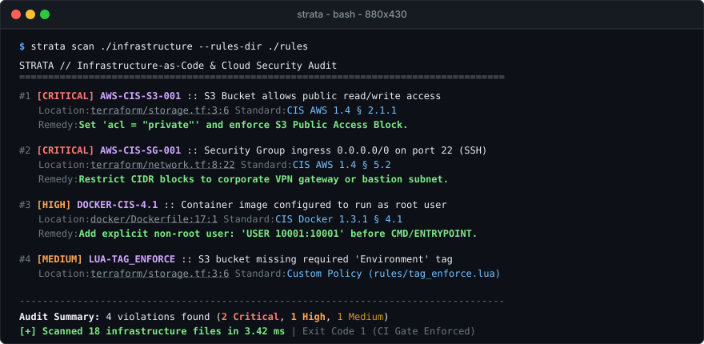
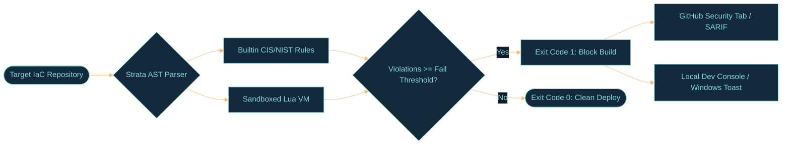

<div align="center">

# Strata

**High-performance, zero-telemetry Infrastructure-as-Code (IaC) security policy engine in Rust.**  
*Audits Terraform, Dockerfiles, and Kubernetes manifests against CIS Benchmarks, NIST 800-53, and sandboxed Lua rules.*

<br/>

[](https://github.com/tkwind/strata/actions)
[](https://www.rust-lang.org/)
[-blue?logo=lua&logoColor=white)](src/security/sandbox.rs)
[](src/rules/builtin.rs)
[](src/report/sarif.rs)
[-success)](PRIVACY.md)
[](LICENSE)

<br/>

<a href="#demo">
  
</a>

</div>

<br/>

> **Over 80% of enterprise cloud breaches trace back to configuration flaws, not zero-days.**  
> A single `0.0.0.0/0` security group rule or `acl = "public-read"` on an S3 bucket can compromise customer databases. Heavyweight scanners take 5-10 seconds and require full Python or Docker runtimes. **Strata executes in under 4 milliseconds with zero telemetry.**

---

## Highlights

* **Sub-4ms AST Inspection:** Pure Rust lexical and syntactic parser for Terraform HCL, Dockerfiles, and Kubernetes YAML specs.
* **15+ CIS & NIST Grounded Rules:** Hard-coded security assertions mapped directly to **CIS AWS Foundations 1.4**, **CIS Docker 1.3.1**, **CIS Kubernetes 1.6**, and **NIST 800-53**.
* **Capability-Isolated Lua 5.4 Sandbox:** Organizations can author custom guardrails in Lua (`rules/*.lua`) without recompiling. The runtime strips `os`/`io`/`package` and enforces a **250,000 CPU instruction step quota** to prevent Denial-of-Service.
* **Zero Telemetry / Air-Gapped Safe:** Compiled with **zero network socket dependencies**. No phone-home analytics, tracking SDKs, or cloud uploads.
* **Native GitHub SARIF v2.1.0:** Emits native SARIF reports to display interactive vulnerability annotations directly in GitHub Pull Request diffs.
* **Local Dev Console (`strata dev`):** Embedded GitHub Primer dark console on `http://127.0.0.1:9090` with real-time AST execution logs and native Windows desktop notification alerts (`--notify`).

---

## Decision & Enforcement Loop



---

## Performance Benchmarks

Evaluated against multi-module cloud infrastructure repositories (500+ infrastructure files):

| Scanner | Language | Scan Latency (500 files) | Binary Size | Sandboxed Extensibility | Network Telemetry |
| :--- | :--- | :--- | :--- | :--- | :--- |
| **Strata** | **Rust** | **~18 ms** | **~4.2 MB** | **Lua 5.4 VM (Isolated)** | **0% (Air-Gapped)** |
| *Checkov* | Python | ~4,200 ms | ~85 MB (Python venv) | Unsandboxed Python | Configurable |
| *Tfsec / Trivy* | Go | ~140 ms | ~45 MB | Rego / OPA | Cloud DB updates |

---

## Quickstart

### 1. Build from Source
```bash
git clone https://github.com/tkwind/strata.git
cd strata
cargo build --release
```

### 2. Run a Scan
```bash
# Scan current directory using standard ANSI terminal table
./target/release/strata scan .

# Enforce strict CI/CD gate: break build (exit code 1) on any HIGH or CRITICAL issue
./target/release/strata scan ./infrastructure --fail-on HIGH

# Export SARIF v2.1.0 report for GitHub Actions
./target/release/strata scan ./infrastructure --format sarif --output strata.sarif

# Dispatch native Windows desktop notification alerts on warnings
./target/release/strata scan ./infrastructure --notify
```

### 3. Launch Local Dev Console
```bash
./target/release/strata dev --port 9090
```
Open **[http://127.0.0.1:9090](http://127.0.0.1:9090)** to view real-time AST execution logs, live diff remediation hints, and test custom Lua scripts in the sandbox.

---

## Writing Custom Sandboxed Lua Policies

Organizations can define custom guardrails without modifying the Rust codebase:

```lua
-- rules/require_environment_tag.lua
function evaluate(resource)
    if resource.resource_type == "aws_s3_bucket" then
        if not resource.attributes.tags or not resource.attributes.tags.Environment then
            return {
                violated = true,
                message = "S3 bucket '" .. resource.resource_name .. "' is missing required 'Environment' tag."
            }
        end
    end
    return { violated = false }
end
```

Run with your custom policy rules:
```bash
strata scan ./infrastructure --rules-dir ./rules
```

<details>
<summary><b>Sandbox Security &amp; Capability Restrictions -></b></summary>
<br/>

Custom policy scripts run in an isolated Lua 5.4 VM ([`src/security/sandbox.rs`](src/security/sandbox.rs)):
* **Stripped Standard Library:** Only `TABLE`, `STRING`, and `MATH` libraries are loaded.
* **Deleted Modules:** `os`, `io`, `loadfile`, `dofile`, `package`, and `require` are scrubbed at runtime.
* **DoS Protection:** Enforces a hard line hook terminating execution after **250,000 CPU instructions**, neutralizing infinite loops and ReDoS attacks.
</details>

---

## Active Security Rule Catalog

<details open>
<summary><b>15+ Built-in CIS Benchmark &amp; NIST 800-53 Assertions -></b></summary>
<br/>

| Rule ID | Severity | Category | Description | Standard |
| :--- | :--- | :--- | :--- | :--- |
| `AWS-CIS-S3-001` | **CRITICAL** | Storage / Public Exposure | S3 Bucket allows public read/write ACL (`public-read`) | CIS AWS 1.4 § 2.1.1 |
| `AWS-CIS-S3-002` | **HIGH** | Storage / Encryption | S3 Bucket missing default server-side encryption | CIS AWS 1.4 § 2.1.2 |
| `AWS-CIS-SG-001` | **CRITICAL** | Network / Ingress | Security Group allows ingress `0.0.0.0/0` on port 22 (SSH) or 3389 (RDP) | CIS AWS 1.4 § 5.2 |
| `AWS-CIS-SG-002` | **HIGH** | Network / Databases | Security Group opens database ports (5432, 3306, 27017) to `0.0.0.0/0` | CIS AWS 1.4 § 5.3 |
| `AWS-CIS-RDS-001` | **CRITICAL** | Database / Exposure | RDS database instance configured with `publicly_accessible = true` | CIS AWS 1.4 § 2.3.1 |
| `AWS-CIS-RDS-002` | **HIGH** | Database / Encryption | RDS database storage volume is unencrypted | CIS AWS 1.4 § 2.3.2 |
| `AWS-CIS-IAM-001` | **HIGH** | IAM / Least Privilege | IAM policy grants wildcard administrative privileges (`Action: *`) | CIS AWS 1.4 § 1.16 / NIST AC-6 |
| `DOCKER-CIS-4.1` | **HIGH** | Container / Privilege | Dockerfile missing non-root `USER` instruction | CIS Docker 1.3.1 § 4.1 |
| `DOCKER-CIS-4.2` | **MEDIUM** | Supply Chain | Base container image pulls unversioned or `:latest` tag | CIS Docker 1.3.1 § 4.2 |
| `DOCKER-CIS-4.3` | **HIGH** | Container / Attack Surface | Dockerfile exposes administrative ports (`EXPOSE 22`, `EXPOSE 2375`) | CIS Docker 1.3.1 § 4.3 |
| `DOCKER-CIS-4.4` | **CRITICAL** | Container / Supply Chain | Dangerous pipe-to-shell command in build layer (`curl \| bash`) | NIST SP 800-190 § 3.1 |
| `K8S-CIS-5.2` | **CRITICAL** | Kubernetes / Breakout | Workload container executes with `privileged: true` | CIS K8s 1.6 § 5.2.5 |
| `K8S-CIS-5.3` | **HIGH** | Kubernetes / Isolation | Pod shares host network namespace (`hostNetwork: true`) | CIS K8s 1.6 § 5.2.4 |
| `STRATA-SEC-001` | **CRITICAL** | Secrets / Leak | Hardcoded AWS IAM Access Key ID detected in configuration | CIS AWS 1.4 § 1.13 |
| `STRATA-SEC-002` | **CRITICAL** | Secrets / Crypto | Committed plaintext private key header detected | NIST 800-53 IA-5 |

</details>

---

## GitHub Actions CI/CD Integration

Enforce pre-merge security gates in `.github/workflows/security.yml`:

```yaml
name: Infrastructure Security Gate

on:
  pull_request:
    branches: [ main ]

jobs:
  strata-scan:
    name: Strata Compliance Audit
    runs-on: ubuntu-latest
    steps:
      - uses: actions/checkout@v4

      - name: Set up Rust
        uses: dtolnay/rust-toolchain@stable

      - name: Build Strata
        run: cargo build --release

      - name: Audit Infrastructure & Export SARIF
        run: |
          ./target/release/strata scan . \
            --format sarif \
            --output strata-results.sarif \
            --fail-on HIGH

      - name: Upload SARIF to GitHub Security Tab
        uses: github/codeql-action/upload-sarif@v3
        if: always()
        with:
          sarif_file: strata-results.sarif
```

---

## Security & Governance

* **[SECURITY.md](SECURITY.md)**: Threat model, capability isolation, and vulnerability disclosure policy.
* **[PRIVACY.md](PRIVACY.md)**: Zero telemetry, local-first guarantee, and credential masking.
* **[CONTRIBUTING.md](CONTRIBUTING.md)**: Guidelines for adding new rules and sandbox policies.
* **[CHANGELOG.md](CHANGELOG.md)**: Version release notes.

---

## License

Licensed under the [Apache License, Version 2.0](LICENSE).
